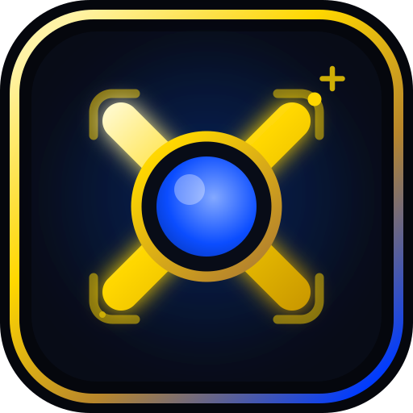
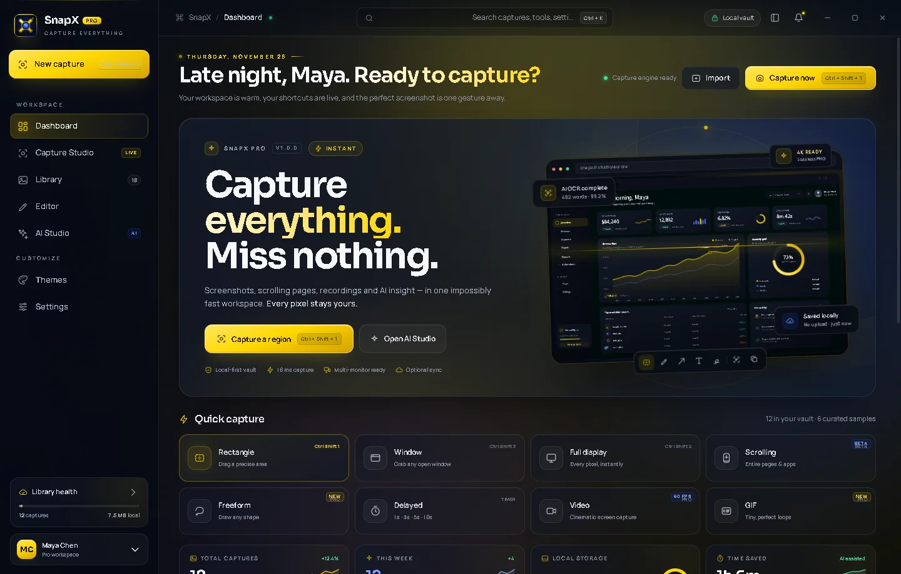
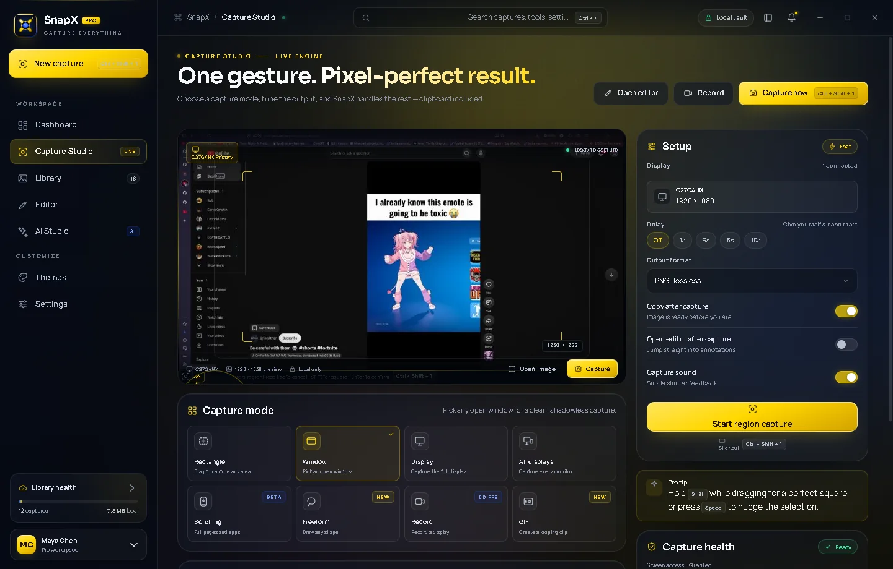
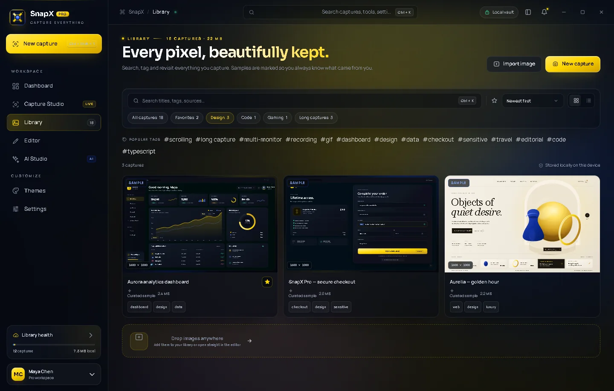
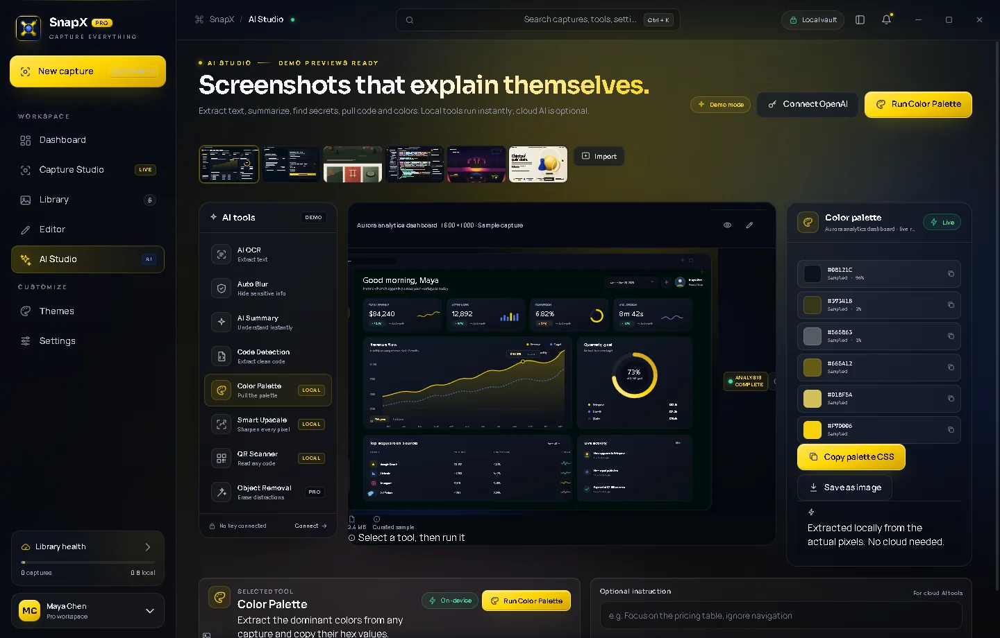
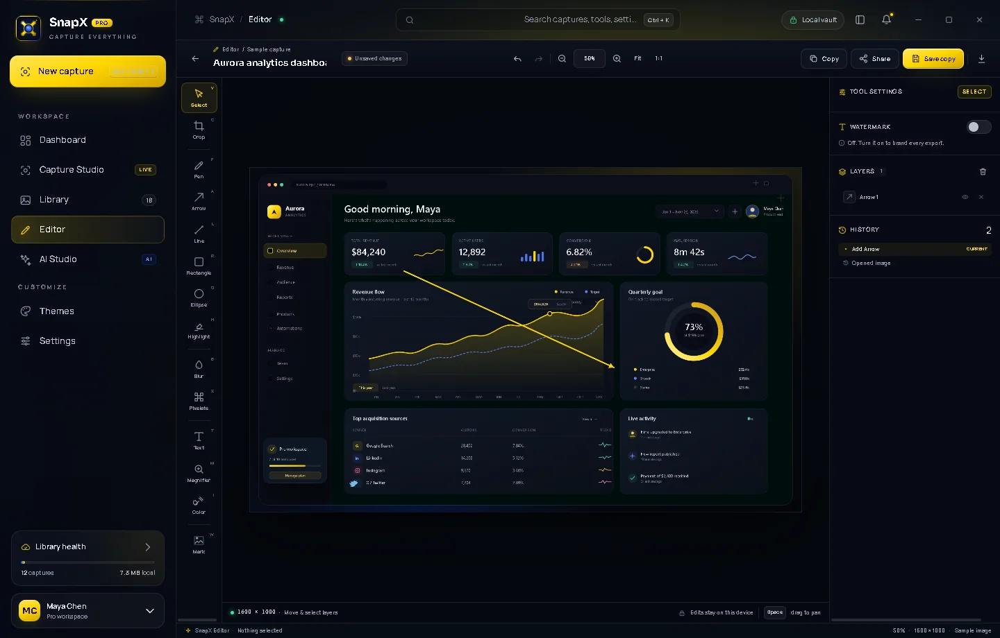
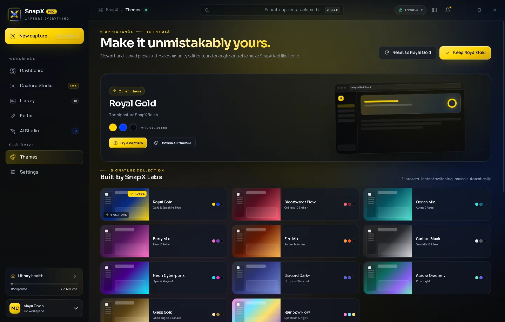

# SnapX Pro

<p align="center">
  
</p>

<h3 align="center">Capture Everything. Miss Nothing.</h3>

<p align="center">
  A premium, local-first screenshot and screen-recording studio for Windows and macOS.<br>
  Built with Electron, vanilla ES modules, and a glass-and-gold interface that feels at home next to Discord, Windows 11, and macOS.
</p>

---

## Why SnapX Pro

Snipping Tool gets the rectangle. SnapX Pro gets the whole workflow: capture, annotate, redact, organize, analyze, record, and share without opening five different apps. Everything is designed to be one shortcut away, with a gallery that stays fast at thousands of captures and a local-first privacy model.

- **Capture anything** — rectangle, window, full display, every monitor, freeform lasso, scrolling capture, timer, video, and GIF.
- **Edit like a pro** — crop, pen, arrows, shapes, highlights, text, blur, pixelate, magnifier, color picker, layers, undo history, watermarks, and 25%–5000% zoom.
- **AI when you want it** — on-device color extraction, 2× upscaling, and QR scanning work with no key. Connect an OpenAI key for OCR, summaries, code detection, sensitive-region detection, and removal planning.
- **A library, not a folder** — instant search, favorites, tags, smart collections, timeline views, previews, drag-and-drop import, and local storage in your Pictures folder.
- **Share without friction** — clipboard, drag-and-drop, Discord webhooks, Imgur uploads, Google Drive handoff, and instant links.
- **Make it yours** — 11 signature themes, 3 community themes, corner radius, density, motion, acrylic, and a floating capture toolbar.

## Screenshots

| Dashboard | Capture Studio |
| --- | --- |
|  |  |
| **Library** | **AI Studio** |
|  |  |
| **Editor** | **Themes** |
|  |  |

## Capture modes

| Mode | Shortcut | What it does |
| --- | --- | --- |
| Region | `Ctrl/Cmd + Shift + 1` | Pixel-precise rectangle with live dimensions, crosshair, magnifier, and arrow-key nudging. |
| Full display | `Ctrl/Cmd + Shift + 2` | Native-resolution capture of the current monitor. |
| Window | `Ctrl/Cmd + Shift + 3` | Pick any open window from a live thumbnail grid. SnapX hides itself first for a clean shot. |
| Floating toolbar | `Ctrl/Cmd + Shift + 4` | A tiny always-on-top capture bar for region, window, display, record, and GIF. |
| All displays | — | Captures every connected monitor at full resolution. |
| Scrolling | — | Beta: saves the visible frame of the selected window and tags it for stitching. |
| Freeform lasso | — | Draw around any shape and capture only what is inside. |
| Delayed | — | 1, 3, 5, or 10 second countdown with a cancelable ring. |
| Video | — | Local WebM recording with 30/60/120 fps options, saved to your Videos folder. |
| GIF | — | Animated GIF recording saved straight into the library. |

## Editor

The canvas editor is built for real work, not demos:

- Crop, pen, arrow, line, rectangle, ellipse, and highlight tools
- Blur and pixelate with adjustable strength and block size
- Text annotations with size, color, and font controls
- Magnifier callouts for zoomed details
- Eyedropper color picker with hex/rgb copy
- Layer list with visibility toggles, selection, and deletion
- Full undo/redo history, watermarking, and PNG export
- Zoom from 25% to 5000%, fit-to-screen, and 1:1 pixel inspection

## AI Studio

SnapX Pro separates **on-device tools** from **optional cloud AI**:

| Tool | Runs locally | Notes |
| --- | --- | --- |
| Color palette | Yes | Extracts real colors from the selected pixels. |
| Smart upscale | Yes | 2× high-quality resampling, saveable to the library. |
| QR scanner | Yes | Uses jsQR locally; no image leaves the device. |
| OCR | With OpenAI key | Without a key, a clearly labeled sample result is shown. |
| Screenshot summary | With OpenAI key | Without a key, a clearly labeled sample result is shown. |
| Code detection | With OpenAI key | Extracts code and an explanation. |
| Sensitive-region detection | With OpenAI key | Returns regions for local pixel blur. |
| Object removal | With OpenAI key | Generates a removal plan. Generative fill is on the roadmap. |

API keys are stored with Electron `safeStorage` and never exposed to the renderer. Sample results are always labeled **Demo**; they are never presented as analysis of your capture.

## Library and themes

- Search across titles, tags, sources, and capture types
- Smart collections for favorites, design, code, gaming, and long captures
- Tag editing, favorite toggles, rename-free simplicity, and instant previews
- Drag-and-drop import from Explorer/Finder
- Timeline-aware sorting and list/grid views
- 11 signature themes plus 3 community editions, with live preview cards
- Local vault count and storage meter

Sample captures ship with the app so the gallery never looks empty. Every sample card and preview is labeled **Sample capture**.

## Sharing

- Copy any capture to the clipboard as an image
- Drag captures out to Discord, Slack, Figma, or any app that accepts files
- Discord: paste a webhook URL in Settings → AI & integrations
- Imgur: add a client ID in Settings → AI & integrations
- Google Drive: saves a local copy and opens Drive for a manual upload (direct OAuth upload is on the roadmap)
- Instant links: copy the local `snapx://` capture path

## Getting started

### Requirements

- Node.js 20 or newer
- Windows 10/11 or macOS 12+
- For macOS screen capture, grant **Screen Recording** permission in System Settings → Privacy & Security

### Run locally

```bash
npm install
npm run dev
```

If your environment blocks npm lifecycle scripts, install Electron manually or run:

```bash
npm rebuild electron
```

### Build installers

```bash
npm run dist:win   # NSIS installer + portable EXE
npm run dist:mac   # DMG + ZIP for arm64 and x64
```

Artifacts are written to `release/`.

### Validate the source

```bash
npm run check
```

## Keyboard shortcuts

| Action | Default |
| --- | --- |
| Region capture | `Ctrl/Cmd + Shift + 1` |
| Full display | `Ctrl/Cmd + Shift + 2` |
| Window capture | `Ctrl/Cmd + Shift + 3` |
| Floating toolbar | `Ctrl/Cmd + Shift + 4` |
| Command palette | `Ctrl/Cmd + K` |
| Cancel overlay | `Esc` |
| Confirm capture | `Enter` |

Shortcuts can be remapped in Settings → Shortcuts.

## Data and privacy

SnapX Pro is local-first by default:

- Captures are stored in `Pictures/SnapX Pro`
- Recordings are stored in `Videos/SnapX Pro`
- Gallery metadata, settings, and secrets live in Electron's per-user `userData` folder
- No telemetry, no analytics, no background uploads
- Cloud AI only runs when you explicitly connect an OpenAI key
- Discord/Imgur sharing only runs when you configure credentials and press Share

The renderer is sandboxed with `contextIsolation`, no Node integration, a strict CSP, and a narrow preload bridge. Capture images are served through a custom `snapx://` protocol with path traversal protection.

## Architecture

```
electron/
  main.js          Main process, windows, IPC, capture, gallery, AI, sharing, tray
  preload.js       Narrow renderer bridge
  overlay.html/js  Full-screen capture overlay with crosshair, magnifier, lasso
  toolbar.html/js  Floating always-on-top capture bar
src/
  index.html       App shell, CSP, titlebar, sidebar, overlays
  styles.css       Design system, themes, layouts, responsive rules
  js/
    app.js         Boot, routing, command palette, activity, drag/drop
    state.js       Normalized settings and capture state
    capture.js     Capture flows and result modals
    recorder.js    WebM and GIF recording
    preview.js     Gallery preview modal
    editor.js      Canvas editor
    themes.js      11 signature + 3 community themes
    data.js        Modes, tools, sample captures, demo AI results
    views/         Dashboard, gallery, capture, studio, themes, settings
```

## CI builds

`.github/workflows/build.yml` builds Windows installers on `windows-latest` and macOS DMGs/ZIPs on `macos-latest` for every push, pull request, tag, or manual dispatch. Artifacts are uploaded to the workflow run, and pushing a `v*` tag publishes a GitHub Release with every installer attached.

macOS builds are unsigned by default. For distribution, add an Apple Developer ID certificate and notarization secrets, then set `CSC_IDENTITY_AUTO_DISCOVERY` and `APPLE_ID`/`APPLE_APP_SPECIFIC_PASSWORD` in the workflow.

## Roadmap

- True scrolling capture stitching
- Direct Google Drive OAuth upload
- Encrypted cloud sync across devices
- Per-capture version history
- Generative object removal
- Plugin system and theme marketplace downloads
- Screen ruler and game-capture profiles
- Signed/notarized release pipeline

## License

MIT © 2026 SnapX Labs
